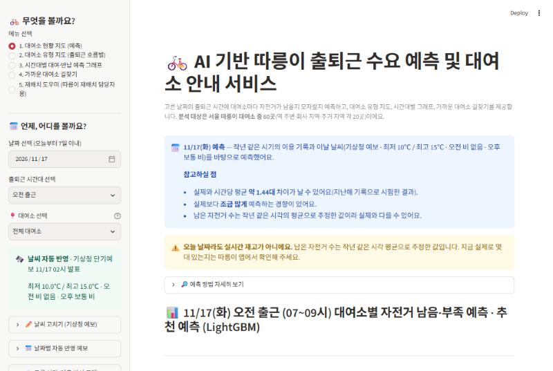
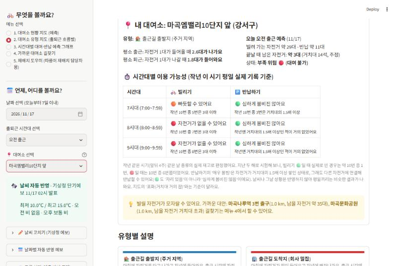
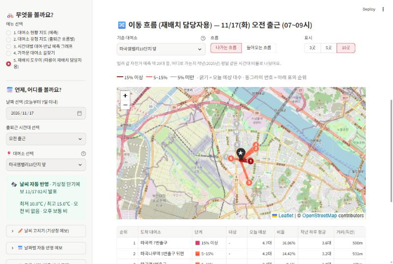

# 따릉이 출퇴근 헛걸음 줄이기 — AI 수요 예측·대여소 안내 서비스

> 서울 따릉이 대여소 60곳을 대상으로, 출퇴근 시간대(07~09시, 18~20시)에 **"빌릴 자전거가 있을까, 반납할 자리가 있을까"**를
> 날짜·날씨별로 미리 알려 주고, 재배치 담당자에게는 자전거가 어디서 빠지고 어디로 흐르는지 보여 주는 Streamlit 서비스입니다.

| 핵심 결과 | 숫자 | 근거 |
|---|---|---|
| 날짜 예측 정확도 | 시간당 평균 오차 **대여 1.44대 · 반납 1.43대**, 작년 같은 시기 평균을 그대로 쓰는 방법(1.82대)보다 **약 21% 정확** | 2025년 테스트(1회만 평가, 524,875행) |
| 헛걸음 미리 알림 | 실제 헛걸음 10번 중 **약 7번**을 🟠·🔴로 미리 경고 | 2023→2024, 2024→2025 두 번 검증 |
| 안내를 따랐을 때 | 🔴 경고 후 1.5km 안 🟢 대여소로 옮기면 빈 대여소를 만날 위험 **62.9% → 12.9%** | 같은 검증. 단, 옮길 곳이 있는 경우는 🔴의 약 40% |
| 부족 표시 보강 | 실제 부족을 미리 잡는 비율 **32~42% → 55~63%** (맞는 비율은 52~56%로 비슷) | 2024·2025 두 해 비교 |

---

## 1. 왜 만들었나

출퇴근 시간 따릉이는 주거지에서 빠져나가 업무지구로 몰립니다. 그래서 **집 앞 대여소엔 자전거가 없고, 회사 앞엔 반납할 자리가 없는** 헛걸음이 반복됩니다.
따릉이 앱은 "지금 몇 대"는 알려 주지만, **"내일 출근 때는 어떨지"**는 알려 주지 않습니다. 이 서비스는 그 빈칸을 채우는 것을 목표로 했습니다.

### 페르소나

| 페르소나 | 필요 | 이 서비스에서 |
|---|---|---|
| 출근길 직장인 (32세, IT 사무직) | 출근 피크 품절·반납 거치대 부족 사전 안내, 대체 대여소 | 1·2·4번 메뉴로 지원 |
| 퇴근길 여가 직장인 (59세, 회사원) | 인기 대여소 부족 정보, 자전거 도로 우선 안내 | 부족 정보는 지원, 자전거 도로 우선 경로는 미지원 |
| 주말 나들이 이용자 (47세, 프리랜서) | 주말·공휴일 여가 시간대 예측 | **미지원** — 예측이 출퇴근 시간대만 다룸 (한계에 명시) |

### 프로젝트 일정

| 단계 | 기간 | 내용 |
|------|------|------|
| 1단계 | 11/2 ~ 11/6 | 데이터 수집 및 데이터 확보 |
| 2단계 | 11/9 ~ 11/13 | 데이터 전처리 & 모델 학습 |
| 3단계 | 11/16 ~ 11/20 | 대시보드 & UI 개발 |
| 4단계 | 11/23 ~ 11/27 | 배포 & 발표 |

---

## 2. 서비스 화면



사이드바에서 **메뉴 → 날짜(오늘부터 7일 이내) → 출근/퇴근 → 대여소**를 고릅니다. 날씨는 **기상청 단기·중기예보가 자동으로 들어가고**, 직접 고칠 수도 있습니다.

| 메뉴 | 누구를 위해 | 무엇을 보여 주나 |
|---|---|---|
| 1. 대여소 현황 지도 (예측) | 이용자 | 대여소별 자전거 부족·거치대 거의 참 예상(지도 색), 예측표, 이름 검색, 주소 기준 가까운 순 정렬 |
| 2. 대여소 유형 지도 (출퇴근 흐름별) | 이용자 | K-Means로 나눈 4가지 대여소 유형, **내 대여소 카드**(시간대별 빌리기·반납하기 🟢/🟠/🔴, 가까운 대안 대여소) |
| 3. 시간대별 대여·반납 예측 그래프 | 이용자 | 고른 날 0~23시 예측 대여·반납 |
| 4. 가까운 대여소 길찾기 | 이용자 | 출발지·도착지 근처 대여소(예측상 위험한 곳은 피함)와 자전거 경로·예상 시간 |
| 5. 재배치 도우미 | 따릉이 재배치 담당자 | 구·유형별 추천 방향(🚚 보충 / 📦 수거 / ✅ 유지), 옮길 방향 후보, 흐름 예보, **대여소별 이동 흐름 화살표** |

| 내 대여소 카드 | 이동 흐름 화살표 |
|---|---|
|  |  |

---

## 3. 데이터

| 데이터 | 내용 |
|---|---|
| 따릉이 대여·반납 이력 | 2021~2025년 서울 전체. 60곳의 시간별 대여 7,665,060건, 반납 7,933,527건 (개인정보 열은 쓰지 않음) |
| 대여소 재고(남은 자전거) | 시간별 재고. 2021년은 원본 없음 |
| 기상 | 기상청 ASOS 서울(108) 시간자료(학습), 기상청 단기·중기예보 API(서비스) |
| 달력 | 2021~2026년 공휴일·대체공휴일 |
| 대여소 정보 | 위치·거치대 수, 2026년 공식 이름(8곳 이름 변경 반영) |

- **대여소 60곳 층화 선정:** 역세권(역 300m 이내) / 업무지구(출근 순유입) / 주거지(출근 순유출) 각 20곳, 23개 자치구.
- **결측 처리:** 기록이 없는 시간을 모두 0으로 채우지 않고, **7일 이상 연속 공백만 결측**으로 남겼습니다(운영 중단으로 판단).
- **검열 인식:** 재고가 0이면 실제 수요보다 대여 기록이 적게 남습니다. 해석할 때 이 점을 구분했습니다.

---

## 4. 예측 방법

### 날짜 예측 (서비스 기본)

고른 날짜 하루를 **작년 같은 시기 이용 기록 + 그날 날씨 + 달력 + 대여소 정보**로 예측합니다.

- 입력: 52주 전 같은 요일·시각 기록, 작년 비슷한 날씨의 날 평균, 일·반일 단위 날씨(기온, 오전·오후 강수 구간, 눈), 요일·공휴일·연휴, 대여소 유형
- 모델: LightGBM(추천), XGBoost, GRU 중 선택 — 세 모델의 2025년 테스트 오차 차이는 2% 이내
- 대여와 반납은 따로 예측하고, **남은 자전거 = 작년 같은 시각 평균 재고 + (예측 반납 − 예측 대여)**로 추정
- 2026년 이용량 감소를 반영해 연간 보정(상반기 증감률의 절반)

| 2025년 테스트 (1회만 평가) | 대여 MAE | 반납 MAE |
|---|---|---|
| **LightGBM (서비스)** | **1.444** | **1.431** |
| XGBoost | 1.451 | 1.441 |
| GRU | 1.468 | 1.434 |
| 작년 4주 평균 그대로 (기준선) | 1.820 | — |
| 최근 4주 평균 (기준선) | 1.602 | — |

- 학습 2022~2023 / 검증 2024 / 테스트 2025로 **시간 순서대로 나누고**, 테스트는 설정을 모두 정한 뒤 **한 번만** 평가했습니다.
- 서비스용 모델은 확정 설정 그대로 2022~2025년 전체로 다시 학습했습니다.


### 그 밖의 분석

| 기능 | 방법 | 검증 |
|---|---|---|
| 대여소 유형 | 2025년 평일 출퇴근 흐름 4가지 값을 표준화 → K-Means(k=4) | 실루엣 점수 0.334 (k=2~6 중 최고 0.343과 비슷, 해석 가능성으로 4 선택) |
| 시간대별 이용 가능성 (🟢/🟠/🔴) | 작년 같은 시기(±4주)·같은 날 종류에 빈 적이 있던 날의 비율 | 🟢일 때 실제로 빈 비율 약 11%, 🔴일 때 약 62% (두 해 같은 결과) |
| 이동 흐름 화살표 | 작년 출발→도착 비율 × 그날 예측 대여 수 | 2024 비율로 2025를 맞혀 보니 상위 10곳 중 약 7곳 유지, 경로별 대수 오차 25~32% |

### 비교용: 1시간 예측 모델 (같은 요일 재생)

고급 설정에서 고를 수 있는 비교 모드입니다. 고른 날짜와 같은 요일의 가장 최근 실제 하루를 1시간 예측 모델에 넣어 다시 계산합니다.

| 모델 | 노트북 | 주요 설정 |
|---|---|---|
| Seasonal Naive | `train_seasonalnaive.ipynb` | 1주(168시간) 전 같은 시각 값 (기준선) |
| LightGBM | `train_lightgbm.ipynb` | `learning_rate=0.05`, `num_leaves=31`, `n_estimators=1500`, Early Stopping(30) |
| LightGBM + Optuna | `train_lightgbm2.ipynb` | TPE 탐색(학습 데이터 10% 샘플, 검증 MAE 최소화) 후 전체 재학습 |
| XGBoost | `train_xgboost.ipynb` | `learning_rate=0.05`, `max_depth=6`, `reg:squarederror` |
| GRU | `train_gru.ipynb` | 범주형 Embedding(8차원) + 수치형 → GRU(64) → Dense(32), Adam(0.005), MAE 손실 |

---

## 5. 검증으로 바꾼 결정

좋아 보이는 기능보다 **숫자로 확인된 기능**을 남기려고, 바꾸기 전에 과거 기록으로 먼저 시험했습니다.

| 결정 | 처음 안 | 검증 결과 | 최종 |
|---|---|---|---|
| '포화' 기준 | 대여소별 상위 10%(P90) 재고 | 실제 포화의 80~90%를 놓침 (F1 0.24·0.15) | 옛 기준(거치대 − 3) 유지 (F1 0.77·0.74), 문구만 '반납 불가' → '거치대 거의 참' |
| 이용 가능성에 그날 예측 섞기 | 작년 빈도 + 그날 예측 | 오히려 덜 맞음 (AUC 0.752 → 0.704) | 작년 빈도만 사용 |
| 반납 '어려움' 기준 | 거치대 − 3 | 시간의 61%가 해당해 정보가 없음 | 거치대 1.5배 이상 쌓임 (🟢 15% / 🔴 70%) |
| '자전거 부족' 표시 | 예측 끝 재고 ≤ 3대 | 실제 부족의 32~42%만 잡음 (작년 평균 재고 추정이 부정확) | 예측 **또는** 작년 기록으로 판정 → 55~63% |
| 남은 자전거 숫자 | '약 N대' | 실제와 평균 약 10대 차이 | '거의 없음·적은 편·넉넉한 편' 구간으로 표시 |
| 재배치 차량 경로 | 수거·보충 경로 계산 | 교통 시간을 반영할 자료가 없음 | 방향만 제안, 경로는 계산하지 않음 |
| 정답 보정 누출 (외부 검토로 발견) | 전체 기간 정답으로 보정 비율 계산 | 학습 끝 4주 정답에 검증 기간 정보가 섞임. 고쳐서 재학습하니 검증 MAE 대여 0%, 반납 +0.33% | 학습 기간 자료로만 계산하도록 규칙 보완, 설정 선택 결론은 그대로 |

결정별 선택지·숫자·이유와 AI 도구 활용 방식: [`docs/DECISIONS.md`](docs/DECISIONS.md)
자세한 기록: 메인 프로젝트 `DEVELOPMENT_LOG.md`, 화면 변경 설명서 `docs/changes_20261117/README.md`

---

## 6. 한계

| 한계 | 내용 |
|---|---|
| 대상 | 서울 따릉이 대여소 중 **60곳**만. 그래서 옮길 대안 대여소가 1.5km 안에 없는 경우가 많음 |
| 재고 | 남은 자전거는 **실시간이 아니라 추정**(평균 약 10대 오차). 지금 몇 대인지는 따릉이 앱에서 확인 |
| 시간대 | 출퇴근(07~09시, 18~20시)만. 주말·낮 여가 시간대 예측 없음 |
| 날씨 | 모델은 실제 날씨로 학습, 서비스는 예보 사용 → 예보가 틀리면 예측도 틀림. 중기예보 날짜는 강수확률로만 판단 |
| 기한 | 날짜 예측은 2025년 기록 기준이라 **2026-12-30**까지만 가능 (2026년 기록으로 갱신 필요) |
| 효과 지표 | "안내를 따랐다면"을 가정한 계산. 사람이 옮기면 그곳 재고도 바뀌는 효과는 반영하지 않음 |
| 거리 | 가까운 순·화살표는 직선거리 |

---

## 7. 기술 스택

| 구분 | 사용 기술 |
|---|---|
| 언어 | Python 3.12 |
| 데이터 처리 | pandas, NumPy, PyArrow (Parquet) |
| 머신러닝 | LightGBM, XGBoost, scikit-learn (K-Means) |
| 딥러닝 | TensorFlow / Keras (GRU) |
| 하이퍼파라미터 튜닝 | Optuna (TPE Sampler) |
| 대시보드 | Streamlit |
| 지도 | Folium, streamlit-folium |
| 외부 API | 기상청 단기·중기예보(공공데이터포털), Kakao 로컬(주소 검색), OSRM 공개 서버(자전거 경로, routing.openstreetmap.de) |
| 개발 환경 | Jupyter Notebook, Google Colab, Git / GitHub |

---

## 8. 팀과 역할

| 이름 | 역할 | 맡은 부분 |
|---|---|---|
| 박기흠 | 팀장 | (작성 필요) |
| (팀원) | | (작성 필요) |
| (팀원) | | (작성 필요) |
| (팀원) | | (작성 필요) |

---

## 9. 실행 방법

### 요구 사항
- Python 3.12
- 인터넷 연결(기상청 예보, 4번 길찾기의 주소 검색·경로)

### 설치 및 실행 (Windows PowerShell)

```
# 1. 저장소 받기
git clone https://github.com/sun111902ringring/ringring.git
cd ringring

# 2. 가상환경 생성 및 활성화
python -m venv .venv
.venv\Scripts\Activate.ps1

# 3. 패키지 설치
pip install -r requirements.txt

# 4. 대시보드 실행
streamlit run app.py
```

### API 키 (선택)

키는 코드에 적지 않고 환경변수나 `.streamlit/secrets.toml`(Git에 올리지 않음)에 넣습니다.

```
# .streamlit/secrets.toml
KMA_SERVICE_KEY = "공공데이터포털 기상청 서비스 키"
KAKAO_REST_KEY = "카카오 REST API 키"
```

- `KMA_SERVICE_KEY`가 없으면 날씨는 **평년값**(같은 시기 평균 기온, 비 없음)으로 예측합니다.
- `KAKAO_REST_KEY`가 없으면 4번 길찾기와 1번 메뉴의 '가까운 순' 정렬을 쓸 수 없습니다.

### 배포
- 배포 링크: (추가 예정)

---

## 10. 폴더 구조

```text
app.py                 Streamlit 앱 (메뉴 1~5)
longterm_c.py          날짜 예측 모델 불러오기·예측
kma_weather.py         기상청 예보 → 모델 날씨 입력
models/                1시간 예측 모델, models/longterm_c/ 날짜 예측 모델
data/                  대여소 목록·유형·이름, 이용 가능성 빈도표, 이동 비율표, data/longterm_c/ 날짜 예측용 기록
scripts/               유형(K-Means)·이용 가능성·이동 비율·대여소 이름 표 만들기
docs/                  화면 변경 설명서
train_*.ipynb          1시간 예측 모델 학습 노트북
```
