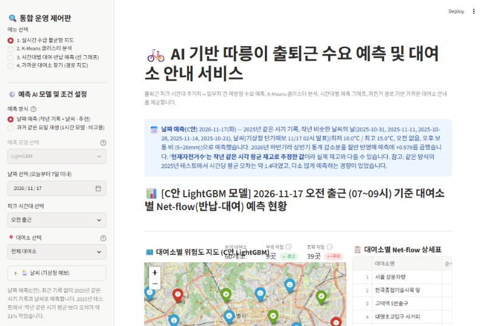
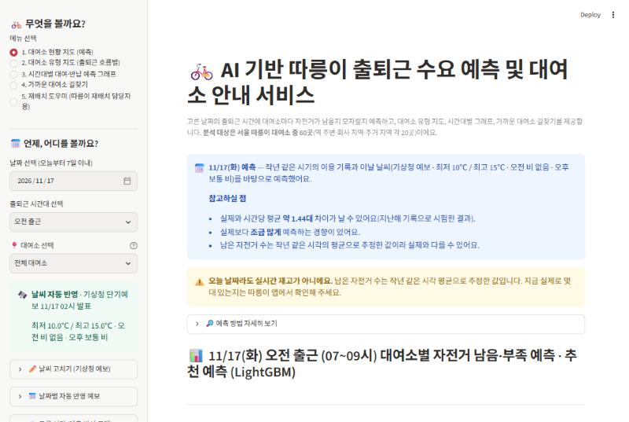
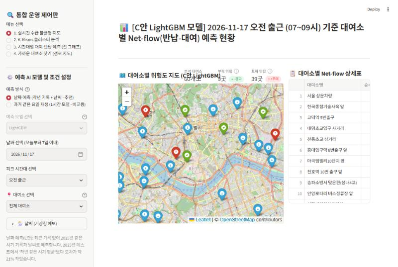
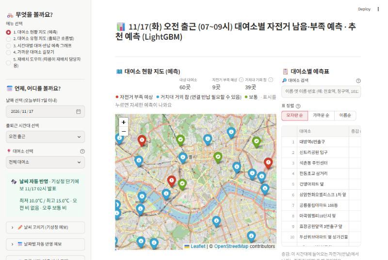
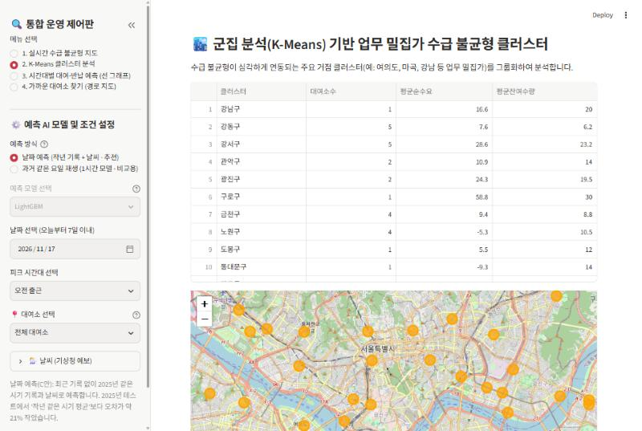
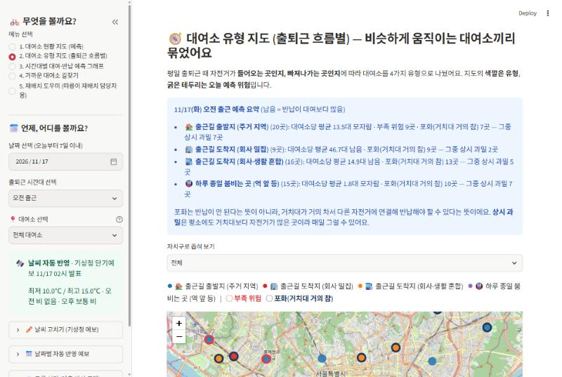
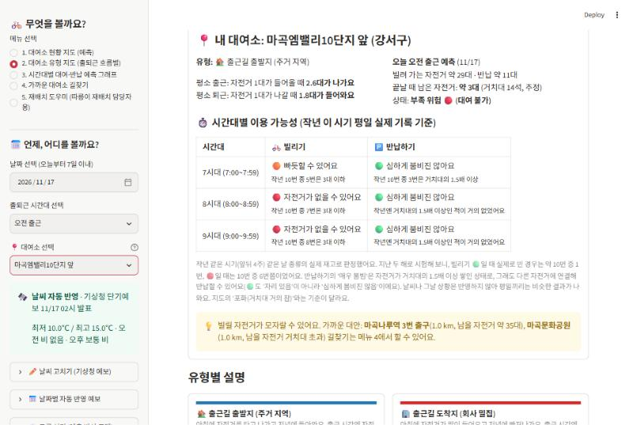
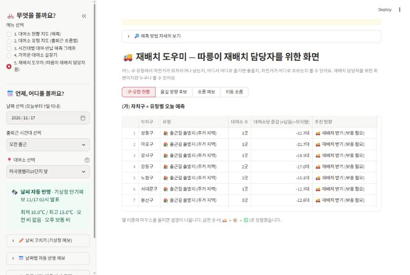
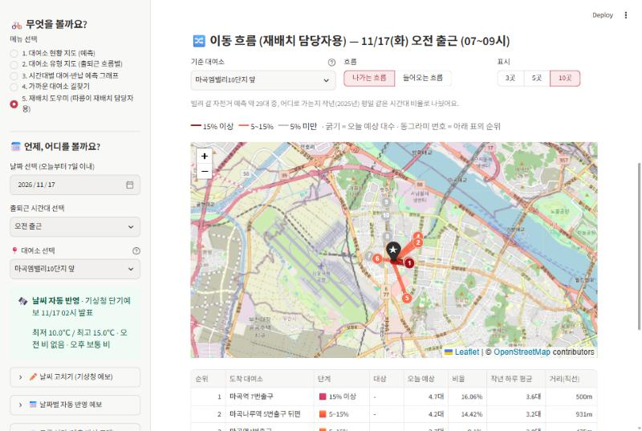

# 2026-11-17 서비스 변경 설명서

**기준:** 어제 커밋(`755927e`, 26.11.16) 화면 → 오늘 작업 후 화면
**대상:** 팀원 · 발표 준비용 · 비전공자도 읽을 수 있게 정리

---

## 한눈에 보기

| 구분 | 바뀐 점 |
|---|---|
| 메뉴 | 4개 → **5개** (재배치 담당자용 '재배치 도우미' 추가), 이름을 쉬운 말로 |
| 첫 화면 | 팀 내부 용어(C안, ×0.979 등)를 빼고 **"얼마나 믿으면 되는지"** 중심으로 안내 |
| 날짜 예측 | 모델 3개(LightGBM·XGBoost·GRU) 중 선택, 기상청 예보 **자동 반영** 표시 |
| 2번 메뉴 | 이름만 K-Means였던 화면 → **실제 K-Means 대여소 유형 지도** |
| 새 기능 | 내 대여소 카드(시간대별 빌리기·반납하기 가능성), 대여소 검색, 가까운 순 정렬, **이동 흐름 화살표** |
| 정확성 | '포화' 기준 검증 후 문구 수정, 대여소 이름 2026년 기준으로 |

---

## 1. 첫 화면과 사이드바

| 작업 전 | 작업 후 |
|---|---|
|  |  |

- **안내 상자:** "날짜 예측(C안) … ×0.979를 곱했습니다 … 테스트 MAE" 같은 내부 용어 →
  "작년 기록과 날씨로 예측했어요 / **실제와 약 1.44대 차이** / **조금 많게 예측하는 경향**"처럼 쉬운 말로. 자세한 근거는 "🔎 예측 방법 자세히 보기"로 접음.
- **오늘 날짜 경고:** "오늘이라도 실시간 재고가 아니에요. 지금 몇 대 있는지는 따릉이 앱에서" 추가.
- **사이드바 순서:** 메뉴 → 📅 날짜·출퇴근 시간대·대여소 → 🛰️ 날씨 자동 반영 → ✏️ 날씨 고치기·📅 날짜별 예보(접힘) → ⚙️ 고급 설정(예측 방식·모델, 접힘).
- **모델 선택:** LightGBM만 → ⭐ 추천 예측(LightGBM) / 비교 예측(XGBoost) / 시간 흐름 예측(GRU). 세 모델 차이는 2% 이내.
- **기한 안내:** 날짜 예측은 2026-12-30까지 가능(2025년 기록 기준). 14일 전부터 미리 안내, 지나면 안내 화면.

## 2. 1번 메뉴: 대여소 현황 지도 (예측)

| 작업 전 | 작업 후 |
|---|---|
|  |  |

- **이름:** "실시간 수급 불균형 지도" → "대여소 현황 지도 (예측)" (실제로는 실시간이 아니라 예측이라서).
- **글자 겹침 해결:** 작업 전에는 지도 제목과 숫자 3개가 겹쳤음 → 위아래로 배치.
- **범례 추가:** 빨강 = 자전거 부족 예상, 파랑 = 거치대 거의 참, 초록 = 보통.
- **표:** "Net-flow 상세표 / 순수요_NetFlow" → "대여소별 예측표 / 증감 (+남음/−모자람)".
- **🔎 대여소 검색:** 이름·옛 이름·번호로 찾기 (예: "청구역" → 신당동주민센터앞, "1012").
- **정렬:** 모자란 순 / **가까운 순**(주소·장소를 넣으면 직선거리 순, 2km 안에 없으면 안내) / 이름순.
- **'포화' 문구:** "반납 불가" → "거치대 거의 참"(다른 자전거에 연결해 반납 가능). 2025년 검증에서 이 기준이 가장 정확했음.

## 3. 2번 메뉴: 대여소 유형 지도 (출퇴근 흐름별)

| 작업 전 | 작업 후 |
|---|---|
|  |  |

- **작업 전 문제:** 이름은 K-Means인데 실제로는 **자치구별로 묶은 표**였고, 지도 점도 모두 같은 주황색.
- **작업 후:** 2025년 평일 출퇴근 기록으로 **실제 K-Means 4개 유형**을 계산.
  - 🏠 출근길 출발지(주거) 20곳 · 🏢 출근길 도착지(회사 밀집) 9곳 · 🏬 회사·생활 혼합 16곳 · 🚇 하루 종일 붐비는 곳 15곳
- **오늘 예측 요약**(유형별 모자람/남음, 부족·포화·상시 과밀 수), **유형 색 지도 + 자치구 필터**, **유형 설명 카드**, **분석 방법(쉬운 설명)**.

### 내 대여소 카드 (사이드바에서 대여소를 고르면 나타남)

- 유형, 평소 출퇴근 모습("1대 들어올 때 2.6대 나가요"), 오늘 예측, 위험하면 **가까운 대안 대여소**.
- **⏱️ 시간대별 이용 가능성:** 작년 같은 시기 실제 기록으로 시각마다 🟢/🟠/🔴.
  - 빌리기: 🟢일 때 실제로 빈 경우 약 10번 중 1번, 🔴일 때 10번 중 6번 (2023→2024, 2024→2025 두 번 검증)
  - 반납하기: '매우 붐빔' = 거치대의 1.5배 이상 쌓임 (🟢 15%, 🔴 70~73%)
  - 날씨는 섞지 않음 (섞으면 검증에서 오히려 덜 맞았음)

## 4. 5번 메뉴(새로): 재배치 도우미 (따릉이 재배치 담당자용)

| 구·유형 현황 | 이동 흐름 화살표 |
|---|---|
|  |  |

선택 버튼 4개:

| 화면 | 내용 |
|---|---|
| 구·유형 현황 | 자치구 × 유형별 증감, **추천 방향**(🚚 재배치 받기 / 📦 수거 후 재배치 / ✅ 유지) |
| 옮길 방향 후보 | 🚚 재배치 받을 곳 ← 가까운 📦 수거할 곳 짝 (방향 제안, 대수·차량 경로는 계산 안 함) |
| 흐름 예보 | 많이 빠져나갈 곳·들어올 곳 상위 5, 증감 크기 지도 |
| **이동 흐름** (서비스 목표 3) | 고른 대여소에서 빌린 자전거가 **어디로 가는지**(또는 어디서 오는지) 상위 10곳 화살표 |

- **이동 흐름 읽는 법:** 굵기 = 오늘 예상 대수, 색 = 비율 단계(진함 15% 이상 / 중간 5~15% / 회색 5% 미만), 동그라미 번호 = 아래 표의 순위. 표시 개수 3/5/10곳.
- **검증:** 2024년 비율로 2025년을 맞혀 보니 상위 10곳 중 약 7곳 유지, 경로별 대수 오차 25~32% → 정확한 대수보다 **흐르는 방향**을 보는 용도.
- 60곳에서 빌린 자전거의 90% 이상이 60곳 **밖**으로 가서, 서울 전체 대여소 좌표로 그림(60곳 밖은 예측 없이 위치만).

## 5. 그 밖의 변경

- **대여소 이름:** 2026년 공식 이름으로 8곳 변경 (예: 서울 상운차량 → 천호역효성해링턴타워 앞). 374번은 위치 확인 전이라 "신당동주민센터앞 (옛 청구역 2번출구 앞)".
- **4번 길찾기:** '포화' 대여소는 대안이 300m 이내로 더 멀 때만 피함 (연결 반납 가능하므로).
- **거치대를 넘는 예측 재고**(예: 108대)는 숫자 대신 "거치대 초과"로 표시.

## 6. 알아 둘 한계

| 한계 | 내용 |
|---|---|
| 대상 | 서울 따릉이 대여소 중 **60곳**만 |
| 재고 | 남은 자전거 수는 실시간이 아니라 **작년 평균 기반 추정** |
| 기한 | 날짜 예측은 **2026-12-30**까지 (2026년 기록으로 갱신 필요) |
| 거리 | 가까운 순·화살표는 **직선거리** |
| 날씨 | 이용 가능성·이동 흐름에는 날씨 미반영 |

## 7. 관련 파일

- 앱: `app.py`
- 계산 스크립트: `scripts/build_station_types.py`(유형), `scripts/build_station_use_freq.py`(이용 가능성), `scripts/build_od_shares.py`(이동 흐름), `scripts/build_station_names_2026.py`(이름)
- 자세한 작업 기록: 메인 프로젝트 `DEVELOPMENT_LOG.md` (2026-11-17 항목)
